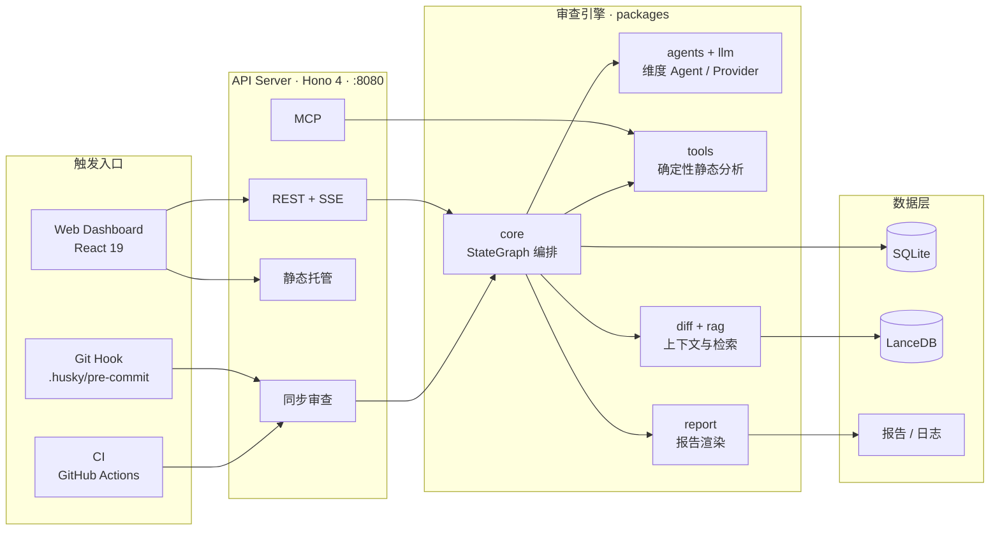
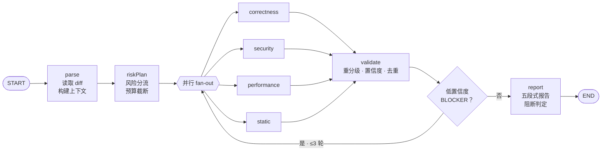

# ReviewFlow

Git 提交 AI 审查与风险分析系统。执行 `git commit` 时自动读取暂存区变更，结合确定性静态分析与 LLM Agent，从正确性、安全、性能等维度生成结构化报告，在代码合入前完成第一轮质量把关。

全栈 TypeScript 单语言实现，pnpm Monorepo + Turborepo。`packages/shared` 的 Zod schema 是配置、API 契约、数据库行类型与前端表单的单一事实源。

## 核心能力

- **多 Agent 并行审查**：正确性 / 安全 / 性能经 LangGraph fan-out 并行执行，交叉验证抑制幻觉，低置信度 BLOCKER 自愈重审。
- **静态优先**：密钥扫描、圈复杂度、AST 解析等确定性工具先行，能由工具判断的问题不交给 LLM。
- **多语言上下文**：JS/TS 用 ts-morph，Python/Go/Java 用 Tree-sitter，按函数边界裁剪；解析失败降级为行级窗口。
- **风险分流与预算**：按 0–100 风险分选择深度 / 快速 / 仅静态分析，并受 token、文件数、变更行数上限约束。
- **四种审查范围**：暂存区、工作区、单个提交、提交区间。
- **RAG 知识库**：AST 切块 + LanceDB 向量 + MiniSearch BM25，RRF 融合后注入上下文，按内容哈希增量索引。
- **Web Dashboard**：报告、diff、行级发现、误报标记、SSE 实时进度、统计分析、配置与规则维护。
- **Hook / CI 一体化**：一键安装 pre-commit hook 或签发 CI 令牌，共用同一同步审查端点与退出码契约。

## 架构



审查流水线：



`static` 节点只跑确定性工具，不消耗 token；`review.dimensions` 关闭的维度在节点内短路。报告由 `packages/report` 确定性渲染，不由 LLM 撰写。

## 目录结构

```text
ai-review-monorepo/
├─ apps/
│  ├─ server/                 @ai-review/server —— Hono API、SSE、Dashboard 静态托管、Hook/MCP 端点
│  │  ├─ src/
│  │  └─ test/
│  └─ web/                    @ai-review/web —— React 19 Dashboard（Vite + Ant Design + ECharts）
│     └─ src/
│        ├─ pages/            登录、注册、首页、个人资料；admin/ 为管理后台页面
│        ├─ views/            发起审查、审查列表、报告详情、统计分析
│        ├─ components/       DiffViewer、SeverityTag、StatChart 等通用 UI
│        ├─ layouts/          用户端 / 管理后台骨架
│        ├─ hooks/            use-auth、use-review-events（SSE）、use-notify
│        ├─ api/              auth / admin 请求封装
│        ├─ lib/              导出、图表主题、查询参数等纯函数
│        └─ styles/           tokens · base · layout · components · pages
├─ packages/                  共享库，统一 src/ + test/ 布局
│  ├─ shared/  diff/  core/  agents/  tools/
│  └─ rag/  llm/  db/  report/
├─ tooling/
│  ├─ eslint-config/          共享 ESLint flat config
│  └─ tsconfig/               共享 tsconfig 预设
├─ scripts/                   构建清理、LLM fixture 录制
├─ docs/                      实现方案、编码规范、审查流程评估、整改记录
├─ .github/workflows/         ci.yml（门禁）· ai-review.yml（PR 审查）
├─ Dockerfile · docker-compose.yml
├─ pnpm-workspace.yaml        workspace 划分 + catalog 依赖版本
├─ turbo.json                 任务依赖图与缓存
└─ package.json · tsconfig 等根级配置
```

| 包                  | 职责                                                | 关键模块                                                   |
| ------------------- | --------------------------------------------------- | ---------------------------------------------------------- |
| `@ai-review/shared` | Zod schema 单一事实源（配置、API、Finding、退出码） | `config-schema` `api` `finding` `severity` `exit-codes`    |
| `@ai-review/diff`   | diff 读取与上下文构建                               | `git-reader` `parser` `context-builder` `ast-foreign`      |
| `@ai-review/core`   | LangGraph 流水线编排                                | `pipeline` `nodes` `state` `risk-planner` `cross-validate` |
| `@ai-review/agents` | 维度 ReviewAgent 与输出校验                         | `review-agent` `dimensions` `prompt` `validate`            |
| `@ai-review/tools`  | 确定性静态分析工具总线                              | `tool-registry` `secret-scan` `complexity` `mcp-server`    |
| `@ai-review/rag`    | 切块、向量 + BM25 检索与融合                        | `chunker` `knowledge-base` `fusion`                        |
| `@ai-review/llm`    | Provider 封装、token 预算、录制回放                 | `provider` `ai-sdk-provider` `budget` `record-replay`      |
| `@ai-review/db`     | Drizzle schema、迁移与各 store                      | `schema` `migrations` `store` `user-store` `log-store`     |
| `@ai-review/report` | 五段式报告渲染                                      | `render` `insights` `pr-comment`                           |

测试与被测源码同包、就近存放（`test/*.test.ts`）；`packages/*` 只允许依赖 `shared` 与更底层包，禁止反向依赖。

## 快速开始

前置要求：Node.js `>=22`，经 Corepack 激活 pnpm `10.24.0`。

```bash
corepack enable
pnpm install
pnpm build
pnpm dev
```

- Web Dashboard：<http://localhost:5173>
- API Server：<http://localhost:8080>（开发期 Vite 将 `/api` 代理到此）

首次打开页面时注册第一个账号，该账号自动获得 `admin` 角色；项目不提供默认管理员密码。之后在 **管理后台 → 配置初始化** 生成 `.ai-review.yml`，再到 **系统配置 / AI 模型** 编辑模型与审查参数。默认 provider 为 `anthropic`，密钥字段支持 `${ENV_NAME}` 引用，只通过环境变量提供：

```bash
export AI_REVIEW_API_KEY="your-api-key"   # PowerShell: $env:AI_REVIEW_API_KEY = "..."
```

生产部署由服务端同端口托管前后端（需先 `pnpm build`）：

```bash
node apps/server/dist/main.js --port 8080 --web-dist apps/web/dist
```

## 常用命令

| 命令             | 说明                                        |
| ---------------- | ------------------------------------------- |
| `pnpm dev`       | Turbo 并行启动 server + web（自动构建依赖） |
| `pnpm build`     | 按依赖图构建所有 workspace                  |
| `pnpm lint`      | ESLint flat config                          |
| `pnpm typecheck` | `tsc --noEmit`                              |
| `pnpm test`      | Vitest 全量测试                             |
| `pnpm format`    | Prettier 格式化                             |
| `pnpm clean`     | 清理构建产物（保留数据库、日志、报告）      |

单包与单测：`pnpm --filter @ai-review/core test`、`pnpm --filter @ai-review/core exec vitest run test/benchmark.test.ts`。

依赖版本只声明在 `pnpm-workspace.yaml` 的 `catalog`，包内使用 `catalog:` 引用；禁止 `any`、`as` 断言与 `@ts-ignore`。提交信息遵循 Conventional Commits（`<type>(<scope>): <subject>`）。

## Git Hook 与 CI

目标仓库先启用 husky v9（执行一次 `pnpm exec husky init`），然后在 **管理后台 → Git Hook 与 CI** 选择仓库点击安装。服务端会写入 `.husky/pre-commit` 与 `.ai-review/hooks/pre-commit.mjs`，签发令牌到 `.ai-review-cache/hook-token`（不进入版本库），并自动补齐 `.gitignore`。

Hook 与 CI 都调用 `POST /api/hooks/review`（Authorization 头携带后台签发的令牌），响应携带 `exitCode`：

| 退出码 | 含义                                   |
| ------ | -------------------------------------- |
| `0`    | 通过，无达到阻断阈值的发现             |
| `1`    | 存在达到 `blockOn` 级别的发现，阻断    |
| `2`    | 配置或环境错误（配置校验、仓库无效等） |
| `3`    | 超时或被取消，不阻断                   |

退出码定义在 `packages/shared/src/exit-codes.ts`，属于稳定契约，不得变更语义。CI 工作流见 `.github/workflows/ai-review.yml`。

## Docker 部署

```bash
docker compose up --build
```

单容器同时提供 API 与 Dashboard（<http://localhost:8080>）。`review-data` volume 挂载到 `/app/.ai-review-cache`，SQLite、审查缓存与向量索引不会因容器重建丢失。模型 API Key 需通过环境变量或管理后台注入。

## 文档

| 文档                                 | 内容                                 |
| ------------------------------------ | ------------------------------------ |
| [项目实现方案](docs/项目实现方案.md) | 完整架构设计、配置项、API 与数据模型 |
| [代码编写规范](docs/代码编写规范.md) | 强制编码约定与评审要求               |
| [审查流程评估](docs/审查流程评估.md) | 审查流水线效果评估与改进记录         |

合入门禁：`pnpm lint → pnpm typecheck → pnpm test` 全绿。
